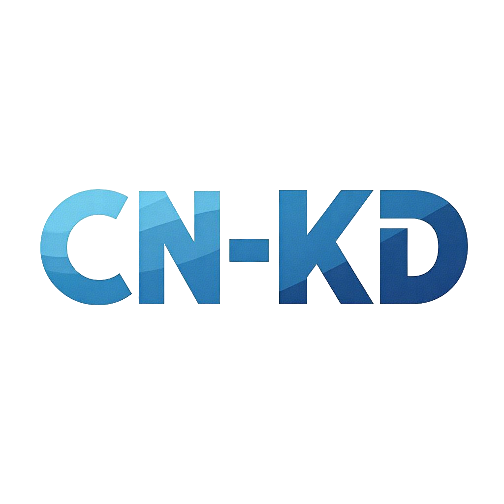

# CNKD NEXT

[简体中文](../../README.md) · **English (US)** · [English (UK)](README.en-GB.md) · [Français](README.fr.md) · [Русский](README.ru.md)

**An independent single-room server for Rusted Warfare, built on RW-HPS.** · [AGPL v3](../../LICENSE)

[Download server](https://github.com/YiChex/CNKD-NEXT-RW-HPS/releases/latest) · [Setup guide (Chinese)](../DEPLOYMENT-GUIDE-CN.md) · [Plugin catalog (Chinese)](../PLUGINS-CN.md) · [Server source](../../server/README.en-US.md)

## A letter to the Rusted Warfare community

Our first thanks go to **Dr. (deng-rui), the original author of RW-HPS, and to everyone who contributed upstream**. RW-HPS’s approach to maintenance and open source has changed over time. Their work made CNKD NEXT possible, and we will continue to credit it in our source and documentation. [RW-HPS](https://github.com/RW-HPS/RW-HPS) · [RW-HPS upstream contributors](../../README.md#contributors)

The CNKD team has maintained this project on top of RW-HPS since February 2026. After careful consideration, we believe the single-room server is ready for more people to share in its maintenance. There is still so much the community could do with it. With the server source now public, we can finally say it: we’re switching careers to play *Wuthering Waves*. 😄

Anyone can open a pull request. Changes can be merged after review, and sustained contributions may lead to maintainer access. If the group of maintainers grows, we may form a GitHub organization and move toward community stewardship. We also plan to open-source the next generation of ranked play, built on CNKD NEXT as an extensible server hub for Rusted Warfare, as soon as we can. [Contribute](../../CONTRIBUTING.md)

Rusted Warfare’s clans have been the strongest force behind the project’s growth. Our thanks to **灰太狼 (Grey Wolf)**, the CNKD team’s earliest supporter, and to **七安 (Qi’an)**, the first clan to use this server. We are grateful to every community team that used it, shared feedback, or helped us improve it. Thank you to the users and teams who have supported and built alongside CNKD Cloud Instances. Above all, thank you for being here.

A friendly nod to the AI tool teams that helped along the way 😄 [OpenAI Group PBC](https://openai.com/) · [DeepSeek (Hangzhou DeepSeek Artificial Intelligence Basic Technology Research Co., Ltd.)](https://www.deepseek.com/)

> May the road ahead cross high mountains and far rivers, and may the code find a home.
>
> Even when the updates pause, may these sparks light the way for those who follow.

**CNKD 薯条 🍟** · [Join QQ group 910085695](https://qm.qq.com/q/YHtlMJwzUm)

  

## Plugin examples and official plugins

| Plugin | What it does | Source and downloads |
| --- | --- | --- |
| Minimal example | One `.hello` command, with Java and Kotlin starter projects. | [Source](https://github.com/YiChex/cnkd-next-plugin-examples) · [Download](https://github.com/YiChex/cnkd-next-plugin-examples/releases/latest) |
| EIRS | Player identity reporting and ban synchronization. The standard package includes the modern adapter. | [Source](https://github.com/YiChex/cnkd-plugin-identity-reporter) · [Download](https://github.com/YiChex/cnkd-plugin-identity-reporter/releases/latest) |
| Postgame analytics | Match data collector and separate report service. | [Source](https://github.com/YiChex/cnkd-match-analytics) · [Download](https://github.com/YiChex/cnkd-match-analytics/releases/latest) |
| Titles and colors | Lobby nicknames, titles, and colors. Use the companion host from the plugin release. | [Source](https://github.com/YiChex/cnkd-next-single-room-titles) · [Download](https://github.com/YiChex/cnkd-next-single-room-titles/releases/latest) |

The standard host supports postgame analytics through `read-statistics`. The titles plugin requires `player-presentation` and comes with a companion host. Check both the required capability and the SDK version. After you install or replace a plugin, regenerate the approval lock for the full installed set. [Plugin catalog (Chinese)](../PLUGINS-CN.md)

## CNKD community sites

- Try the server and manage its settings in a visual panel. [CNKD Cloud Instances](https://cloud.cnkd.fun/)
- Find Rusted Warfare clan tournaments and community events. [CNKD Esports](https://esports.cnkd.fun/)
- Browse maps and follow updates to the resource site. [CNKD Map Resources](https://rw.cnkd.fun/maps)
- Connect to the CNKD Rusted Warfare RKC relay node for room-code direct connections and public community play. [CNKD RKC Relay Node](https://www.cnkd.fun/)
- Explore the CNKD Rusted Warfare central-server showcase and automated lottery server. [CNKD Central Server Showcase](https://lucky.cnkd.fun/)

## Start here

Public release `2.3.2` contains server `1.1.24` and Plugin SDK `1.3.0`. Manual Start defaults to a five-second countdown. Ordinary players can change slots and enter or leave spectator team S when the lobby locks allow it.

Download the flat ZIP from Releases, extract it into a separate instance directory, and use Java 17. Run `sh ./start.sh` on Linux or `start-windows.bat` on Windows. Verify the configuration with `startmode bootcheck` and `config check` in the server console. [Setup guide (Chinese)](../DEPLOYMENT-GUIDE-CN.md)

## License

CNKD NEXT server source is distributed under the **GNU Affero General Public License v3 (AGPL v3)**, as is upstream RW-HPS. Keep copyright and license notices and follow the corresponding-source terms when they apply. Third-party dependencies and game assets retain their own licenses. [AGPL v3](../../LICENSE) · [RW-HPS](https://github.com/RW-HPS/RW-HPS/blob/master/LICENSE)
