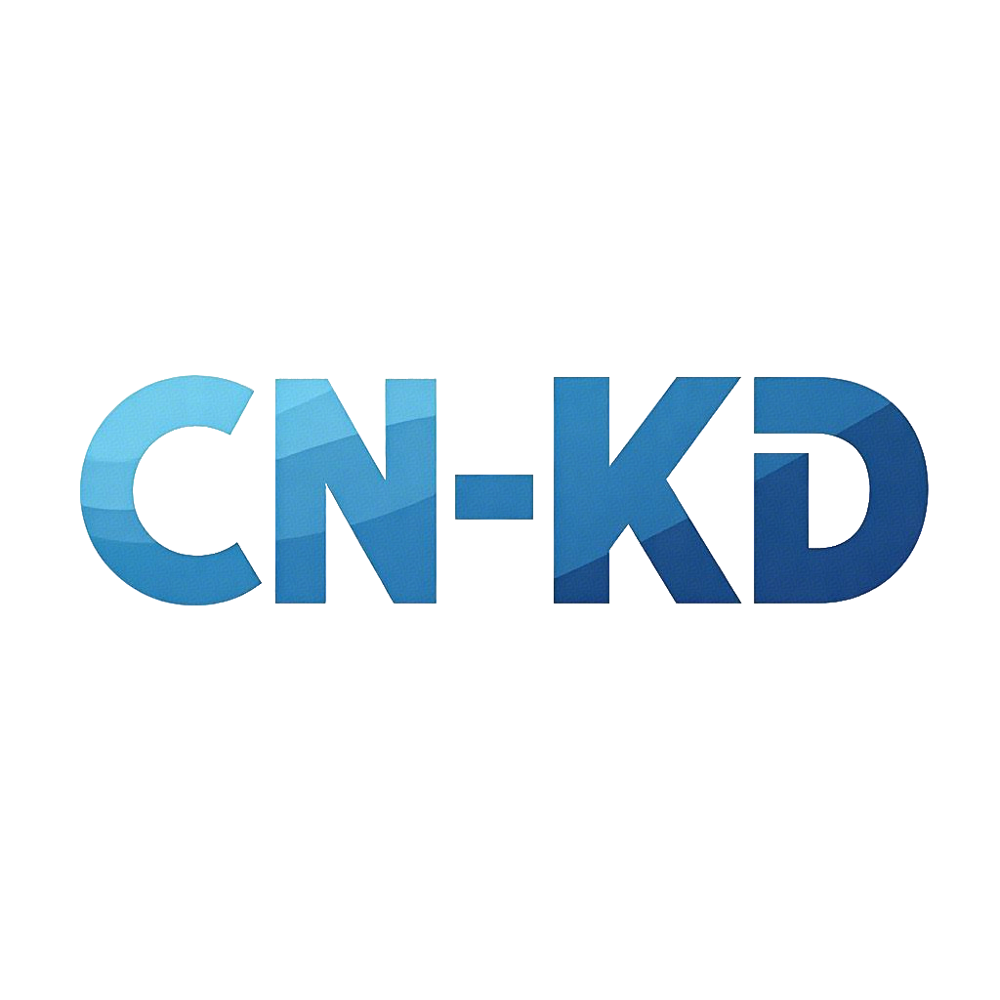

# CNKD NEXT

[简体中文](../../README.md) · [English (US)](README.en-US.md) · [English (UK)](README.en-GB.md) · [Français](README.fr.md) · **Русский**

**Независимый сервер Rusted Warfare с одной игровой комнатой на базе RW-HPS.** · [AGPL v3](../../LICENSE)

[Скачать сервер](https://github.com/YiChex/CNKD-NEXT-RW-HPS/releases/latest) · [Установка (на китайском)](../DEPLOYMENT-GUIDE-CN.md) · [Каталог плагинов (на китайском)](../PLUGINS-CN.md) · [Исходный код сервера](../../server/README.ru.md)

## Письмо сообществу Rusted Warfare

Прежде всего мы благодарим **Dr. (deng-rui), автора RW-HPS, и всех, кто вносил вклад в исходный проект**. Подход к публикации и сопровождению RW-HPS со временем менялся. Именно их работа заложила основу CNKD NEXT, и мы сохраняем сведения об авторстве в коде и документации. [RW-HPS](https://github.com/RW-HPS/RW-HPS) · [Участники исходного проекта RW-HPS](../../README.md#contributors)

Команда CNKD развивает этот проект на базе RW-HPS с февраля 2026 года. Взвесив всё, мы решили, что сервер с одной комнатой достаточно зрел для совместного сопровождения. Сообщество ещё не раз сможет нас удивить. Теперь, когда исходный код сервера открыт, можем наконец признаться: мы меняем профессию и уходим играть в *Wuthering Waves*. 😄

Любой желающий может открыть pull request. Изменения можно принять после проверки, а постоянным участникам команда может предоставить права, необходимые для сопровождения. Если число сопровождающих вырастет, мы рассмотрим создание организации на GitHub и постепенный переход к поддержке силами сообщества. Мы также планируем как можно скорее открыть код следующего поколения рейтинговой системы на базе CNKD NEXT, расширяемой серверной платформы для Rusted Warfare. [Внести вклад](../../CONTRIBUTING.md)

Кланы Rusted Warfare стали главной движущей силой проекта. Спасибо **灰太狼 (Серый Волк)**, самому первому стороннику команды CNKD, и **клану 七安 (Циань)**, первой команде, которая начала пользоваться сервером. Мы благодарим все сообщества, которые его попробовали, делились замечаниями и помогали его улучшать. Спасибо пользователям CNKD Cloud Instances и командам, вместе с которыми развивается эта экосистема. Самое важное хочется сказать просто: спасибо, что вы с нами.

С улыбкой благодарим и команды ИИ-инструментов, которые помогали нам в работе 😄 [OpenAI Group PBC](https://openai.com/) · [DeepSeek (Hangzhou DeepSeek Artificial Intelligence Basic Technology Research Co., Ltd.)](https://www.deepseek.com/)

> Пусть дорога ведёт через высокие горы и дальние реки, а код найдёт свой дом.
>
> Даже когда обновления стихнут, пусть эти искры освещают путь тем, кто придёт следом.

**CNKD 薯条 🍟** · [Вступить в группу QQ 910085695](https://qm.qq.com/q/YHtlMJwzUm)

  

## Примеры и официальные плагины

| Плагин | Назначение | Код и загрузка |
| --- | --- | --- |
| Минимальный пример | Одна команда `.hello` и шаблоны для Java и Kotlin. | [Код](https://github.com/YiChex/cnkd-next-plugin-examples) · [Скачать](https://github.com/YiChex/cnkd-next-plugin-examples/releases/latest) |
| EIRS | Передача сведений об игроках и синхронизация блокировок. В стандартный пакет входит современный адаптер. | [Код](https://github.com/YiChex/cnkd-plugin-identity-reporter) · [Скачать](https://github.com/YiChex/cnkd-plugin-identity-reporter/releases/latest) |
| Послематчевая статистика | Сбор данных о матчах и отдельный сервис отчётов. | [Код](https://github.com/YiChex/cnkd-match-analytics) · [Скачать](https://github.com/YiChex/cnkd-match-analytics/releases/latest) |
| Титулы и цвета | Псевдонимы, титулы и цвета в лобби. Используйте сервер из выпуска плагина. | [Код](https://github.com/YiChex/cnkd-next-single-room-titles) · [Скачать](https://github.com/YiChex/cnkd-next-single-room-titles/releases/latest) |

Стандартный выпуск поддерживает послематчевую статистику через `read-statistics`. Плагину титулов нужен `player-presentation`, поэтому к нему прилагается отдельный сервер. Проверяйте нужную возможность и версию SDK. При установке или замене плагина заново сформируйте файл одобрения для всего набора установленных плагинов. [Каталог плагинов (на китайском)](../PLUGINS-CN.md)

## Ресурсы сообщества CNKD

- Попробуйте сервер и настройте его через визуальную панель. [CNKD Cloud Instances](https://cloud.cnkd.fun/)
- Турниры и события кланов Rusted Warfare. [CNKD Esports](https://esports.cnkd.fun/)
- Каталог карт и обновления сайта ресурсов. [CNKD Map Resources](https://rw.cnkd.fun/maps)

## С чего начать

Публичный выпуск `2.3.2` включает сервер `1.1.24` и SDK плагинов `1.3.0`. При ручном запуске матча по умолчанию начинается пятисекундный отсчёт. Игроки могут менять место, переходить в команду наблюдателей S и возвращаться из неё, если это разрешают настройки комнаты.

Скачайте ZIP из раздела Releases и распакуйте его в отдельный каталог экземпляра сервера. Используйте Java 17. В Linux запустите `sh ./start.sh`, в Windows — `start-windows.bat`. Для проверки настроек выполните в консоли `startmode bootcheck` и `config check`. [Установка (на китайском)](../DEPLOYMENT-GUIDE-CN.md)

## Лицензия

Исходный код сервера CNKD NEXT распространяется по **GNU Affero General Public License v3 (AGPL v3)**, как и исходный проект RW-HPS. Сохраняйте уведомления об авторских правах и лицензии и соблюдайте требования к предоставлению соответствующего исходного кода, когда они применимы. Для сторонних зависимостей и игровых ресурсов действуют их собственные лицензии. [AGPL v3](../../LICENSE) · [RW-HPS](https://github.com/RW-HPS/RW-HPS/blob/master/LICENSE)
